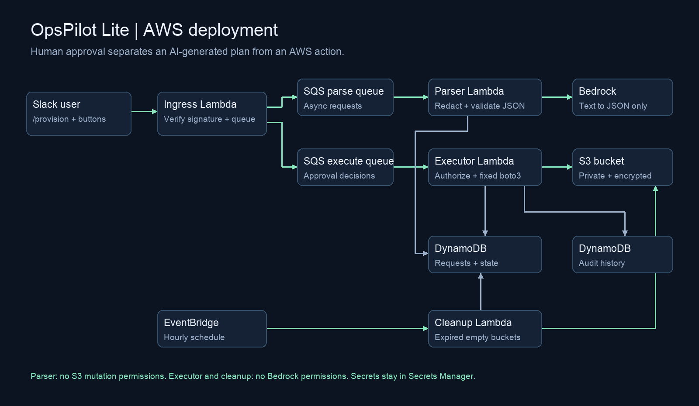

# OpsPilot Lite


> A human approved, policy constrained path from a natural language Slack request to a temporary AWS resource.

A Slack-to-AWS provisioning workflow for an infrastructure engineering portfolio. A user requests a temporary dev/test S3 bucket; an LLM extracts a strict JSON plan; Python validates it; a separately authorized Slack user approves it. Python executes one allowlisted action, records the lifecycle, and cleans up expired empty buckets.

## Project status

The local integration is working end to end: Slack slash command, DeepSeek parsing through an OpenAI compatible endpoint, Pydantic validation, separate-user approval, audit state, and the boto3 executor in dry-run mode. The repository also contains CDK infrastructure for an AWS deployment. The recorded local demo does not claim that the AWS stack has been deployed.

The current safety defaults are deliberate:

- `DRY_RUN=true`: approval reaches the executor but no bucket is created.
- `STORAGE_BACKEND=sqlite`: local state is easy to inspect and reset.
- Only `create_s3_bucket` is allowlisted.
- Only `dev` and `test` environments and TTLs from 1 to 72 hours are accepted.

## Why this project

OpsPilot demonstrates practical AI systems engineering rather than an unguarded chatbot. The model proposes a typed action; application code validates it, a human approves it, and least-privilege execution code performs the allowlisted operation. This separates model output from infrastructure side effects.



## Architecture

```text
Slack /provision
        |
        v
Immediate acknowledgement (< 3 seconds)
        |
        v
LLM provider adapter -> redaction -> Pydantic schema validation
        |
        v
SQLite or DynamoDB request state + audit record
        |
        v
Slack approval card (approver must be allowlisted and not requester)
        |
        v
Conditional state claim -> boto3 S3 executor -> audit result
        |
        v
Hourly cleanup of expired, empty OpsPilot resources
```

The AWS deployment replaces local threads and SQLite with API Gateway, Lambda, SQS, DynamoDB, EventBridge, and Secrets Manager.

## Run the browser demo

~~~bash
python3.11 -m venv .venv
.venv/bin/pip install -r requirements-dev.txt
.venv/bin/python -m app.demo
~~~

Open http://127.0.0.1:8000. Submit the example request, approve as Morgan, then try approval as Alex or Visitor. Try the invalid request button and reject another request. State and audit data persist in demo.sqlite3. Stop the server and delete that file to reset.

**This is a local simulator:** the parser is deterministic, AWS execution is forced to dry run, and identities are selectable. It shares the real application's validation, authorization, state transitions, and executor. It is bound to localhost and must never be used as a public API for real provisioning.

## Local Slack app

1. Create a Slack app using slack-manifest.json. Enable Socket Mode, generate an app token with connections:write, and install it in your test workspace.
2. Copy .env.example to .env and fill in the bot token, app token, signing secret, and a second user's Slack ID as approver. Invite the bot to the demo channel.
3. Run:

~~~bash
set -a
source .env
set +a
.venv/bin/python -m app.local
~~~

Use /provision create a dev bucket named campus-demo for 2 hours. Requester approval and unlisted users are refused. Local defaults use SQLite, the mock parser, and dry run. For an OpenAI-compatible DeepSeek endpoint, set LLM_PROVIDER=deepseek, DEEPSEEK_BASE_URL, DEEPSEEK_API_KEY, and DEEPSEEK_MODEL. For live Bedrock, set LLM_PROVIDER=bedrock and supply an AWS profile with model access. A provider integration is isolated in app/llm.py; the current supported providers are bedrock, deepseek, openai_compatible, and mock.

### DeepSeek-compatible provider

Copy `.env.example` to `.env` and set the credentials locally. Never commit `.env` or paste a key into an issue, video, or README. The adapter sends an OpenAI-compatible `POST /chat/completions` request and parses the response as JSON; Pydantic remains the final authority.

```dotenv
LLM_PROVIDER=deepseek
DEEPSEEK_BASE_URL=https://api.deepseek.com
DEEPSEEK_API_KEY=replace-me
DEEPSEEK_MODEL=deepseek-chat
```

For a compatible gateway, replace the base URL and model with values from that provider. The demo used a DeepSeek-compatible relay; it did not use Bedrock.

## AWS deployment preparation

The repository is deployable, but a real Slack/AWS demo still needs your own accounts. Create an AWS account, enable billing alerts, and create a Slack workspace where you can install an app and test with a second user. Do not paste tokens or access keys into this repository or chat. Use an AWS profile or IAM Identity Center locally.

The stack contains API Gateway, four Lambda functions (ingress, parser, executor, cleanup), two SQS queues with dead-letter queues, DynamoDB request/audit tables, an hourly EventBridge rule, and a reference to an existing Secrets Manager secret. SQS is necessary to keep LLM calls and AWS operations out of Slack's three-second acknowledgement window.

Create a Secrets Manager JSON secret containing SLACK_BOT_TOKEN and SLACK_SIGNING_SECRET. Never put these in CDK context or commit them. Install the AWS CLI and CDK bootstrap once, then:

~~~bash
.venv/bin/python scripts/package_lambda.py
npx --yes --package aws-cdk cdk bootstrap
npx --yes --package aws-cdk cdk synth \
  -c slack_secret_arn=YOUR_COMPLETE_SECRET_ARN \
  -c approver_user_ids=U_SECOND_USER \
  -c dry_run=true
~~~

When ready to deploy, replace synth with deploy. The output SlackRequestUrl goes in both the slash command Request URL and the interactivity Request URL. Disable Socket Mode for the HTTP deployment. Use a test channel with two Slack accounts. Bedrock defaults to amazon.nova-lite-v1:0; model access and regional support must be checked during deployment. For real creation, pass -c dry_run=false.

After deployment, send one request from the requester account and approve it from the allowlisted second account. Verify the request row, audit rows, and S3 tags before recording the demo. Keep dry_run=true for the first smoke test; set it to false only after reviewing the IAM change set.

The Lambda package uses Linux Python 3.11 wheels, so it can be built from macOS without Docker. Re-run packaging after any source edit. Use an AWS region such as us-east-1 for the initial demo. The S3 executor supplies the required LocationConstraint in other regions.

## What to demo

1. Submit a request and show the validated approval message.
2. Attempt approval as the requester; show the refusal.
3. Approve as a configured second user; show private/encrypted S3 creation or the explicit dry-run result.
4. Click again; show duplicate prevention.
5. Request a production bucket or 200-hour lifetime; show rejection.
6. Show audit records and the hourly cleanup policy.

See docs/demo-script.md for a recording outline. A public demo link and an actual video are deployment/recording follow-up work; neither is claimed to exist yet.

## Resume wording

> Built a Slack-to-AWS provisioning workflow in Python using Slack Bolt, DeepSeek, Pydantic, and boto3. Implemented structured LLM parsing, schema validation, separate-user approval, audit logging, duplicate prevention, and safe dry-run S3 execution with encryption, public access blocking, TTL tags, and allowlisted actions.

When describing this repository, call the current run a local Slack demo with dry-run AWS execution. Describe the CDK/Lambda/DynamoDB/EventBridge path as deployment infrastructure unless you have deployed and verified it.

## Verification

~~~bash
.venv/bin/ruff check app infra tests scripts
.venv/bin/ruff format --check app infra tests scripts
.venv/bin/python -m pytest -q
~~~

Tests use mocked Bedrock and moto for S3/DynamoDB. They cover schema rejection, redaction, approver authorization, duplicate delivery/clicks, concurrent claims, encryption, public access blocking, tags, empty-bucket cleanup, and conditional DynamoDB state updates. Live Slack/AWS behavior requires credentials and deployment.

## Safety and practical limits

- Approvers must be allowlisted and different from the requester. The HTTP adapter verifies Slack signatures and timestamp freshness through Slack Bolt.
- TTL is a resource lifetime, not DynamoDB TTL: records are retained for auditing. Cleanup runs hourly, so deletion may lag expiry by about an hour.
- Only empty buckets are deleted. Nonempty buckets become cleanup_failed for manual handling; contents are preserved. No object deletion permission is granted.
- Common token/email/phone patterns are redacted; regex redaction is not a complete sensitive-data detection system. Keep demo requests free of personal data and credentials.
- Conditional claims prevent duplicate execution. A Lambda crash after claiming executing/deleting requires operator reconciliation; AWS and DynamoDB cannot share one atomic transaction.
- Audit writes and state changes currently use separate calls. A database outage between them can leave a missing audit entry; inspect logs and reconcile before reprocessing.
- Failure to configure a bucket triggers compensating deletion. Failed compensation requires manual removal of the generated bucket. The executor cannot create resources outside the opspilot- prefix.
- The parser role has no S3 mutation permission. The executor and cleanup roles have no Bedrock permission. IAM is enforced by prefix; ownership tags are checked in application code.
- Request and audit tables use RETAIN. Removing the stack does not remove those tables or provisioned buckets. Manage retained resources deliberately.
